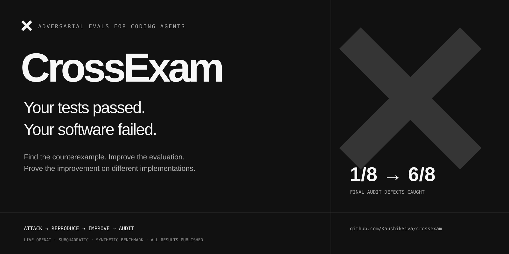
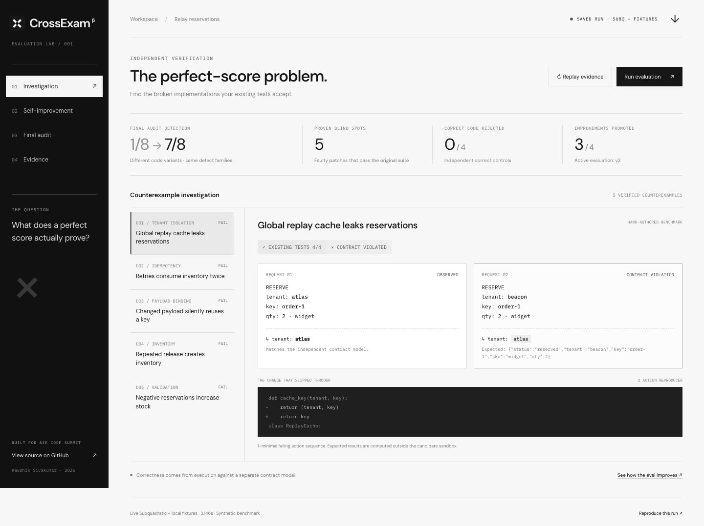
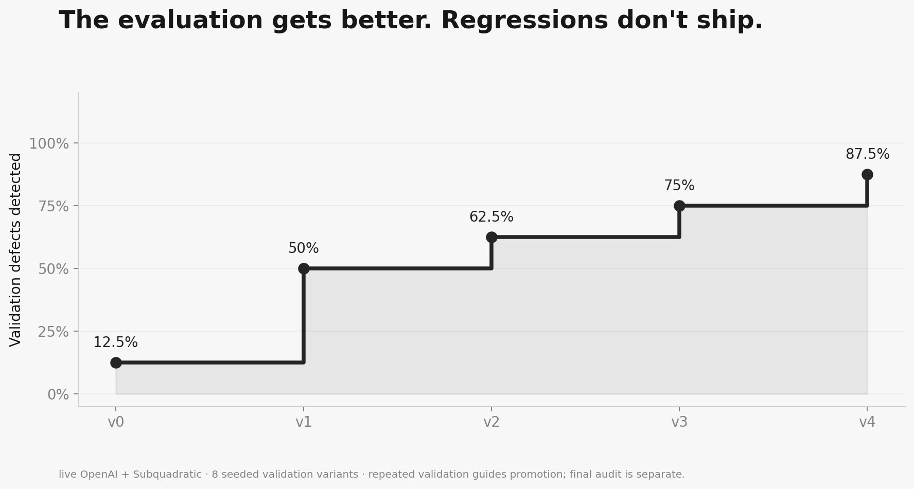
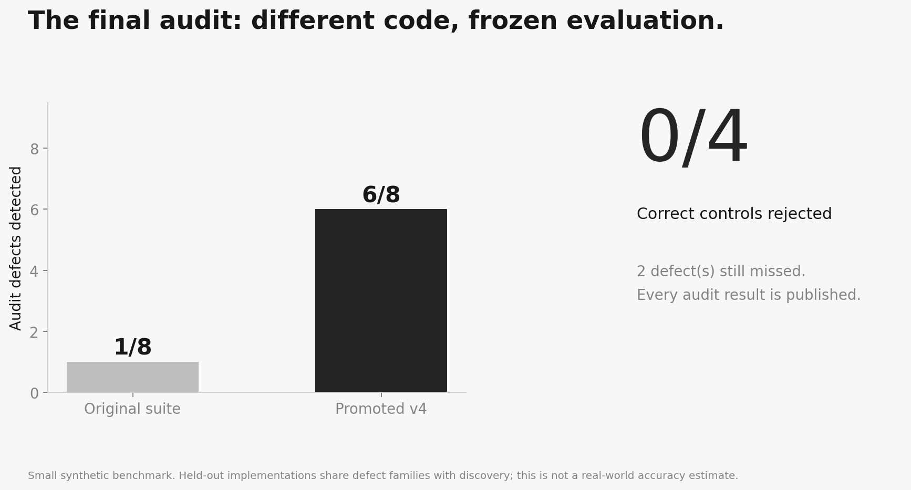
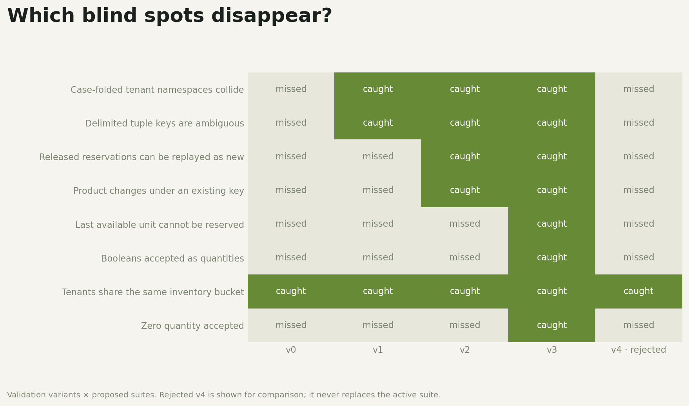
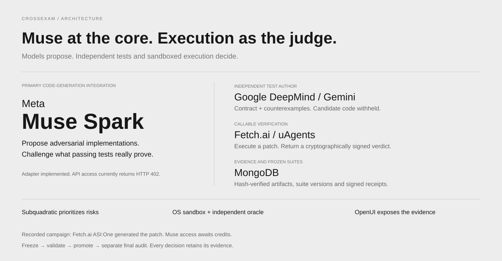
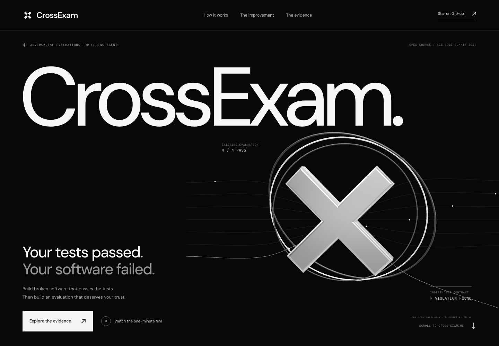
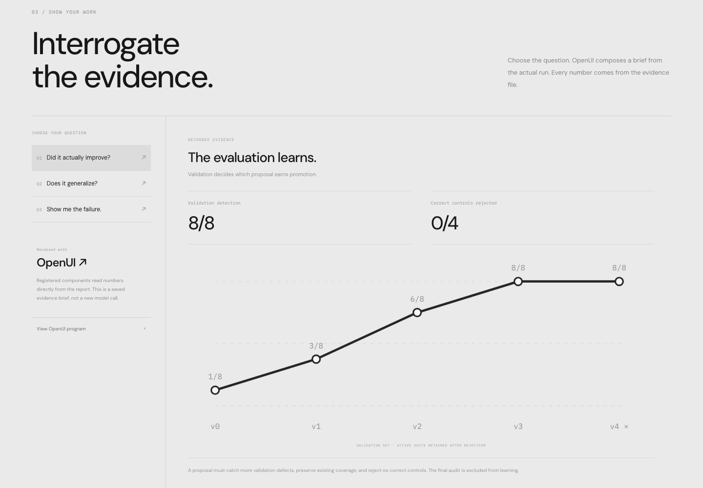

<p align="center"></p>

<p align="center">
  <a href="https://github.com/KaushikSiva/crossexam/actions/workflows/verify.yml"></a>
  <a href="LICENSE"></a>
  
  <a href="https://github.com/thesysdev/openui"></a>
</p>

<p align="center"><strong>Find broken software your tests accept. Prove that stronger evaluations help.</strong></p>
<p align="center"><a href="https://kaushiksiva.github.io/crossexam/">Explore CrossExam</a> · <a href="https://kaushiksiva.github.io/crossexam/demo.html">Watch the one-minute demo</a> · <a href="https://kaushiksiva.github.io/crossexam/lab/">Inspect the evidence</a> · <a href="docs/methodology.md">Methodology</a></p>

A coding agent can produce a patch that passes every test and still violates the product contract. CrossExam challenges the **evaluation itself**: find a faulty implementation it accepts, reproduce the failure, propose stronger tests, and keep only changes that earn promotion on separate validation work.

The final audit opens **after learning ends**. Correct implementations must keep passing. A cheaper but weaker evaluation is rejected.

## The reveal

This cache optimization passes all four original scenarios:

```diff
 def cache_key(tenant, key):
-    return (tenant, key)
+    return key
```

Two customers use the same request ID. **Beacon receives Atlas's reservation.** CrossExam reduces the violation to two requests. Executable checks determine whether the failure is real.



## Measured improvement

The reproducible local benchmark and the completed Subquadratic-routing campaign both produced:

| Measure | Original evaluation | Promoted evaluation |
| --- | ---: | ---: |
| Final-audit seeded defects caught | 1 / 8 | **7 / 8** |
| Correct controls rejected | 0 / 4 | **0 / 4** |
| Validation defects caught | 1 / 8 | **8 / 8** |

Five faulty discovery implementations passed the original suite. Three improvements were promoted; an explicitly injected regression challenge was rejected. One final-audit defect remained undetected and is published with the other results.

**Small synthetic benchmark—not a production accuracy estimate.** Audit implementations are withheld from model prompts within a campaign, but the public corpus shares defect families with discovery. The evaluation suite improves; model weights do not change. [Scope and limitations →](docs/methodology.md)



| Final audit | Coverage across versions |
| --- | --- |
|  |  |

## Quick start

The Python engine has **no third-party dependencies**. Use Python 3.11+ on macOS with `sandbox-exec`, or a running Docker daemon on Linux.

```bash
git clone https://github.com/KaushikSiva/crossexam.git
cd crossexam

# Linux: docker pull python:3.12-slim
python3 -m crossexam doctor
python3 -m crossexam run
python3 -m crossexam serve
```

Open **http://127.0.0.1:8847**. Start a real campaign, inspect counterexamples, compare versions, and download the evidence. Local mode uses labeled hand-authored attack/test fixtures and makes no API calls.

Replay the published failure, or use a frozen suite as a process-exit merge gate:

```bash
python3 -m crossexam replay docs/evidence/release-local/counterexamples/D01

python3 -m crossexam verify fixtures/relayqueue \
  --suite docs/evidence/release-local/suite-v3.json
```

`verify` exits 0 when the candidate passes, 1 when blocked, and 2 for setup errors. The prototype supports the documented reservation API; it does not infer arbitrary repository interfaces.

## Live partner modes

```bash
cp .env.example .env
# Set your own credited MODEL_API_KEY and SUBQ_API_KEY in .env.

# Live risk routing + explicitly local attacks/proposals:
python3 -m crossexam run --subq-only

# Live routing + Meta-generated attack and independent test proposals:
python3 -m crossexam run --live
```

| Integration | Role | Verified status |
| --- | --- | --- |
| **Subquadratic / SubQ Snap 1.1** | Rank contract risks from repository, specification, and existing tests | Complete routing campaign succeeded; its routing call used 1,898 input tokens in 0.781 s |
| **Meta Model API / Muse Spark** | Generate an adversarial implementation; independently generate tests without its source | Adapter implemented. Current live request returned HTTP 402; a successful Meta campaign is pending credited access |
| **OpenUI** | Compose interactive briefs from components bound to actual report data | Implemented and browser-tested |

No paid API runs in CI. Missing keys and provider failures are visible errors; live mode never silently substitutes fixtures. Requests, responses, usage, latency, and hashes are saved without authorization headers or keys.

## How it stays independent



1. **Risk router:** Subquadratic prioritizes contract boundaries to investigate.
2. **Attacker:** Meta sees the implementation and baseline scenarios. A proposed patch must pass the old evaluation to count as a blind spot.
3. **Executor:** The sandboxed candidate sees inputs, never expected outputs. A separate event-ledger oracle computes contract outcomes.
4. **Test author:** A fresh Meta context sees the specification and observed failures, without implementation or attacker reasoning. It returns JSON scenarios, not executable assertions.
5. **Promotion:** Frozen tests must catch additional validation defects, preserve previous detections, and reject no correct control.
6. **Final audit:** Different implementations are evaluated after proposals finish. Audit results never return to the model during the campaign.

Separate contexts do not eliminate shared-model blind spots. The specification, oracle, operating system, and host orchestrator remain trusted assumptions.

## A UI that shows the receipts

React, Three.js, Motion, and [OpenUI](https://github.com/thesysdev/openui) power the landing page. A component such as `MeasuredMetric("audit")` reads its numbers from the saved report. Current briefs use recorded programs and are labeled accordingly.





```bash
cd site
npm ci
npm run dev
```

The monochrome hero uses real-time 3D geometry, studio lighting, and pointer-responsive depth. A vector fallback supports devices without WebGL.

The published site is read-only. Code execution and paid API calls run in the local workspace.

## Reproduce and challenge it

```bash
python3 -m unittest discover -s tests -v

# Optional browser checks, with the Python server running:
npm ci
npx playwright install chromium
npm run qa
```

[GitHub Actions](https://github.com/KaushikSiva/crossexam/actions) tests behavior, sandbox enforcement, bounded output, promotion invariants, context separation, event hashes, and audit ordering. It also executes a complete campaign in Docker.

Presentation scripts recreate figures, narration, browser recordings, and evidence exports. Generate the requested V4 track with `python3 scripts/elevenlabs_voice.py`; identical requests reuse the cached audio. The final narration uses ElevenLabs V4 with the premade Brian voice. Script and audio hashes are published in `docs/assets/narration-provenance.json`.

```text
crossexam/  Sandbox, oracle, promotion engine, providers, CLI, local server
fixtures/   Reservation service and explicit API contract
tests/      Behavioral, containment, and evaluation-integrity checks
web/        Local evidence workspace
site/       React + Three.js + Motion + OpenUI landing source
docs/       Published site, figures, evidence archives, methodology
scripts/    Export, plotting, QA, narration, and recording tools
```

The most useful contribution is a new defect the evaluation misses—or correct code it wrongly rejects. [Contributing →](CONTRIBUTING.md)

Built by **[Kaushik Sivakumar](https://github.com/KaushikSiva)** for the **AIE Code Summit Hackathon, November 7, 2026**. Primary track: **Trust but Verify**. Versioned suite improvements also address **The System That Gets Better**. [Submission material →](docs/submission.md)

MIT licensed. If you want evaluations that can show their work, star the project and bring a counterexample.
