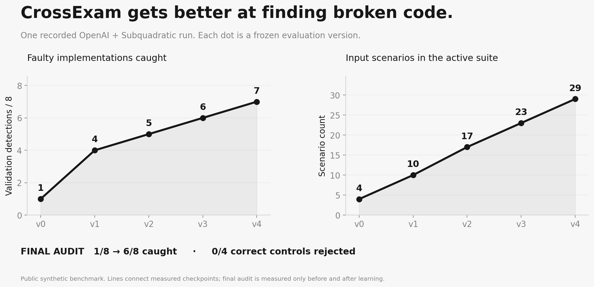
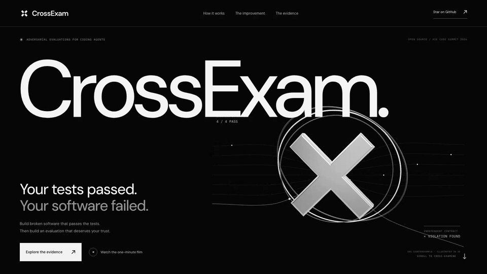

 <p align="center"></p>

<p align="center">
  <a href="https://github.com/KaushikSiva/crossexam/actions/workflows/verify.yml"></a>
  <a href="LICENSE"></a>
  
  <a href="https://github.com/thesysdev/openui"></a>
</p>

<p align="center"><strong>Find broken software your tests accept. Prove that stronger evaluations help.</strong></p>
<p align="center"><a href="https://kaushiksiva.github.io/crossexam/">Explore CrossExam</a> · <a href="https://kaushiksiva.github.io/crossexam/demo.html">Watch the one-minute demo</a> · <a href="https://kaushiksiva.github.io/crossexam/lab/">Inspect the evidence</a> · <a href="docs/methodology.md">Methodology</a></p>

A coding agent can produce a patch that passes every test and still violates the product contract. CrossExam challenges the **evaluation itself**: find a faulty implementation it accepts, reproduce the failure, propose stronger tests, and keep only changes that earn promotion on separate validation work.

The final audit opens **after learning ends**. Correct implementations must keep passing. Only strict gains are promoted; rejected proposals remain in the record.

## The reveal

This cache optimization passes all four original scenarios:

```diff
 def cache_key(tenant, key):
-    return (tenant, key)
+    return key
```

In this labeled seeded example, two customers use the same request ID. **Beacon receives Atlas's reservation.** CrossExam reduces the violation to two requests. Executable checks determine whether the failure is real.


## Measured improvement

The latest **30-case-per-split campaign** catches **24/30 final-audit faults, up from 5/30**, with **0/4 correct controls rejected**. Validation improves from **1/30 to 23/30**. The final audit opens only after all four proposal rounds finish.



| Measure | Original evaluation | Promoted evaluation |
| --- | ---: | ---: |
| Input scenarios per implementation | 4 | **34** |
| Faulty final-audit implementations caught | 5 / 30 | **24 / 30** |
| Correct controls rejected | 0 / 4 | **0 / 4** |
| Faulty validation implementations caught | 1 / 30 | **23 / 30** |

**Meta Muse Spark is the primary code-generation integration in the architecture.**. This measured campaign explicitly uses **Fetch.ai ASI:One** for the attack and **Google DeepMind Gemini 3.8 Flash** for independent tests. The generated patch removes tenant identity from cache keys and passes all four baseline scenarios; two requests expose the customer-data leak.

| Evaluation version | Proposed scenarios | Validation detections | Correct controls rejected | Decision |
| --- | ---: | ---: | ---: | --- |
| v0 | 4 | 1 / 30 | 0 / 4 | Baseline |
| v1 | 11 | 12 / 30 | 0 / 4 | Promoted |
| v2 | 19 | 18 / 30 | 0 / 4 | Promoted |
| v3 | 27 | 22 / 30 | 0 / 4 | Promoted |
| v4 | 34 | 23 / 30 | 0 / 4 | Promoted |

The campaign took **156.654 seconds**: one Subquadratic call, one ASI:One call, and four Gemini calls. **40 evidence artifacts** were archived to local MongoDB Community and read back with SHA-256 verification. [Complete campaign evidence →](docs/evidence/expanded30-live-005/) · [MongoDB readback →](docs/mongodb-verification.json)

The expanded corpus retains the original eight faults in each split and adds 22 distinct faulty implementations to each: **30 validation faults, 30 audit faults, and four correct controls**. Every added fault has an executable contract witness in `tests/test_benchmark.py`. All 44 witnesses also pass on every correct control. They are qualification checks, never model prompts or injected live test proposals.

Six audit faults remain missed: A01, A02, A10, A14, A17, and A28. All are visible in the report. The previous campaign's **8/8** belongs to the smaller benchmark; it is preserved unchanged and is not a direct comparison with **24/30**. Earlier weaker and incomplete attempts remain available. [Development history →](docs/campaigns.json)

**Small public synthetic benchmark, not a production accuracy estimate.** Audit implementations are withheld from model prompts within each campaign, but the corpus was already observed during development. The suite improves; model weights do not. [Scope and limitations →](docs/methodology.md)

| Final audit | Coverage across versions |
| --- | --- |
|  |  |

## A verification agent other agents can call

Fetch.ai also powers a real **uAgents verification service**. A coding agent sends a signed candidate-code request. CrossExam loads the promoted suite from MongoDB, checks its content hash, runs the candidate in the OS sandbox, and returns a cryptographically signed verdict bound to that exact request, candidate, and suite. The proof is stored in MongoDB's `verifications` collection.

The recorded exchange blocks the model-generated faulty patch and accepts the correct implementation. The requesting client verifies both signatures. This is local HTTP transport between agent identities; no Agentverse registration or token payment is claimed.

```bash
pip install -r requirements-fetch-agent.txt
# Configure MONGODB_URI, then archive a completed campaign.
python3 -m crossexam archive runs/YOUR_RUN
python3 -m crossexam agent --port 8868

# In another terminal, use the IDs from mongodb-receipt.json and agent-info.json:
python3 -m crossexam agent-verify fixtures/relayqueue \
  --campaign CAMPAIGN_ID --address AGENT_ADDRESS \
  --out runs/correct-verification.json
```

`agent-verify` exits 0 for PASS, 1 for BLOCKED, and 2 for setup or verification errors. The service uses the documented reservation API; it does not infer arbitrary interfaces. [Signed faulty-patch receipt →](docs/evidence/fetch-agent-30/broken-receipt.json) · [Signed correct-patch receipt →](docs/evidence/fetch-agent-30/correct-receipt.json)

## Quick start

The Python engine has **no third-party dependencies**. Use Python 3.11+ on macOS with `sandbox-exec`, or a running Docker daemon on Linux.

```bash
git clone https://github.com/KaushikSiva/crossexam.git
cd crossexam

# Linux: docker pull python:3.12-slim
python3 -m crossexam doctor
python3 -m crossexam run
python3 -m crossexam serve
```

Open **http://127.0.0.1:8847**. Start a real campaign, inspect counterexamples, compare versions, and download the evidence. Local mode uses labeled hand-authored attack/test fixtures and makes no API calls.

Replay the published failure, or use a frozen suite as a process-exit merge gate:

```bash
python3 -m crossexam replay docs/evidence/release-local/counterexamples/D01

python3 -m crossexam verify fixtures/relayqueue \
  --suite docs/evidence/release-local/suite-v3.json
```

`verify` exits 0 when the candidate passes, 1 when blocked, and 2 for setup errors. The prototype supports the documented reservation API; it does not infer arbitrary repository interfaces.

## Live partner modes

```bash
cp .env.example .env
# Set OPENAI_API_KEY and SUBQ_API_KEY in .env.
# OPENAI_MODEL defaults to gpt-5.4-mini-2026-03-17.

# Live risk routing + explicitly local attacks/proposals:
python3 -m crossexam run --subq-only

# Live routing + OpenAI-generated attack and four adaptive test proposals:
python3 -m crossexam run --live

# Primary architecture: Muse code generation + independent Gemini tests.
# Requires credited MODEL_API_KEY, GEMINI_API_KEY and SUBQ_API_KEY.
python3 -m crossexam run --live --generator meta --test-author gemini

# Google DeepMind / Gemini generates the attack; Fetch.ai / ASI:One authors tests:
# Set GEMINI_API_KEY, ASI_ONE_API_KEY, and SUBQ_API_KEY in .env.
python3 -m crossexam run --live --generator gemini --test-author fetchai

# Either provider can also handle both roles, always in separate contexts:
python3 -m crossexam run --live --generator gemini
python3 -m crossexam run --live --generator fetchai
```

| Integration | Role | Verified status |
| --- | --- | --- |
| **Subquadratic / SubQ Snap 1.1** | Rank contract risks from repository, specification, and existing tests | Live routing succeeded; 1,898 input tokens in 1.016 s in the published OpenAI campaign |
| **OpenAI / GPT‑5.4 mini** | Generate a faulty patch and four independently authored test proposals | Five successful live generation calls; all artifacts published |
| **Meta Model API / Muse Spark** | Primary code-generation integration: propose adversarial implementations |  |
| **Google DeepMind / Gemini 3.8 Flash** | Independently author stronger tests | Four successful live calls; four promotions reach 23/30 validation and 24/30 final-audit detections |
| **Fetch.ai / ASI:One + uAgents** | Generate attacks; expose CrossExam as a callable verification agent | Live ASI:One attack reproduced; real uAgents requests block faulty code and accept correct code with verified signed receipts |
| **MongoDB** | Archive evidence, retrieve frozen evaluations, and store signed verification receipts | 40 campaign artifacts archived and read back from local MongoDB Community 8.0.13; two agent proof records stored |
| **OpenUI** | Compose interactive briefs from components bound to actual report data | Implemented and browser-tested |

No paid API runs in CI. Missing keys and provider failures are visible errors; live mode never silently substitutes fixtures. Requests, responses, usage, latency, and hashes are saved without authorization headers or keys.

`--generator` selects the attacker. `--test-author` optionally selects a different provider for all four proposals; otherwise it uses the attacker’s provider in fresh contexts. Both roles share the eight-call campaign budget. Test authors receive the contract, input scenarios, reproduced observations, and aggregate validation feedback; they never receive candidate code or audit variants. The local workspace exposes the same choices in **New campaign**.

Gemini defaults to `gemini-3.8-flash` (`GEMINI_MODEL`); ASI:One defaults to `asi1-mini` (`ASI_ONE_MODEL`). `GOOGLE_API_KEY` / `GEMINI_APLKEY` and `ASI1_API_KEY` / `FETCHAI_KEY` are accepted key aliases. Fetch.ai supports ASI:One model calls and the optional uAgents verification service. The demonstrated agent uses local transport; it is not registered on Agentverse. API references: [Gemini structured output](https://ai.google.dev/gemini-api/docs/generate-content/structured-output), [Gemini models](https://ai.google.dev/gemini-api/docs/models), [ASI:One structured data](https://docs.asi1.ai/documentation/build-with-asi-one/structured-data).

### MongoDB evidence archive

The core engine still needs no Python packages. Install the optional [PyMongo driver](https://www.mongodb.com/docs/languages/python/pymongo-driver/current/) only when archiving:

```bash
python3 -m venv .venv
source .venv/bin/activate
pip install -r requirements-mongodb.txt
# Set MONGODB_URI in .env; MONGODB_DATABASE defaults to crossexam.

python3 -m crossexam run --live --generator gemini --test-author fetchai --mongo
# Or archive existing evidence without repeating model calls:
python3 -m crossexam archive runs/YOUR_RUN
python3 -m crossexam verify-archive runs/YOUR_RUN
```

Archiving is opt-in via `--mongo`, the archive command, or the workspace checkbox. `campaigns` stores audit summaries and artifact references; `artifacts` stores the exact UTF-8 evidence files by SHA-256, including reports, suites, counterexamples, provider receipts, and the event journal. Artifact content stays JSON/text so invalid API inputs retain their exact types and field names. Artifacts upload first, then the campaign record. Repeated uploads are idempotent; a failed archive keeps local evidence and can be retried. Each artifact is limited to 15 MB. A successful upload writes a local `mongodb-receipt.json` with the campaign ID. Credentials and unrelated files are excluded.

`python3 -m crossexam doctor` reports whether credentials are configured; it does not claim provider access or database connectivity has been verified. Live results and failed attempts are recorded separately; configured credentials alone do not count as a successful integration. MongoDB was verified locally; an Atlas API key alone cannot authenticate database reads and writes.

## How it stays independent


1. **Risk router:** Subquadratic prioritizes contract boundaries to investigate.
2. **Attacker:** Muse Spark is the primary integration; this recorded run uses ASI:One while Muse access is pending. The attacker sees the implementation and baseline scenarios. A proposed patch must pass the old evaluation to count as a blind spot.
3. **Executor:** The sandboxed candidate sees inputs, never expected outputs. A separate event-ledger oracle computes contract outcomes.
4. **Test author:** A fresh Gemini context sees the specification and observed failures, without implementation or attacker reasoning. It returns JSON scenarios, not executable assertions.
5. **Promotion:** Frozen tests must catch additional validation defects, preserve previous detections, and reject no correct control.
6. **Final audit:** Different implementations are evaluated after proposals finish. Audit results never return to the model during the campaign.

Separate contexts and different providers do not eliminate correlated model blind spots. The specification, oracle, operating system, and host orchestrator remain trusted assumptions.

## A UI that shows the receipts

React, Three.js, Motion, and [OpenUI](https://github.com/thesysdev/openui) power the landing page. A component such as `MeasuredMetric("audit")` reads its numbers from the saved report. Current briefs use recorded programs and are labeled accordingly.




```bash
cd site
npm ci
npm run dev
```

The monochrome hero uses real-time 3D geometry, studio lighting, and pointer-responsive depth. A vector fallback supports devices without WebGL.

The published site is read-only. Code execution and paid API calls run in the local workspace.

## Reproduce and challenge it

```bash
python3 -m unittest discover -s tests -v

# Optional browser checks, with the Python server running:
npm ci
npx playwright install chromium
npm run qa
```

[GitHub Actions](https://github.com/KaushikSiva/crossexam/actions) tests behavior, sandbox enforcement, bounded output, promotion invariants, context separation, event hashes, and audit ordering. It also executes a complete campaign in Docker.

Presentation scripts recreate figures, narration, browser recordings, and evidence exports. Generate the requested V4 track with `python3 scripts/elevenlabs_voice.py`; identical requests reuse the cached audio. The final narration uses ElevenLabs V4 with the premade Brian voice. Script and audio hashes are published in `docs/assets/narration-provenance.json`.

```text
crossexam/  Sandbox, oracle, promotion engine, providers, CLI, local server
fixtures/   Reservation service and explicit API contract
tests/      Behavioral, containment, and evaluation-integrity checks
web/        Local evidence workspace
site/       React + Three.js + Motion + OpenUI landing source
docs/       Published site, figures, evidence archives, methodology
scripts/    Export, plotting, QA, narration, and recording tools
```

The most useful contribution is a new defect the evaluation misses—or correct code it wrongly rejects. [Contributing →](CONTRIBUTING.md)

Built by **[Kaushik Sivakumar](https://github.com/KaushikSiva)** for the **AIE Code Summit Hackathon, November 7, 2026**. Primary track: **Trust but Verify**. Versioned suite improvements also address **The System That Gets Better**. [Submission material →](docs/submission.md)

MIT licensed. If you want evaluations that can show their work, star the project and bring a counterexample.
